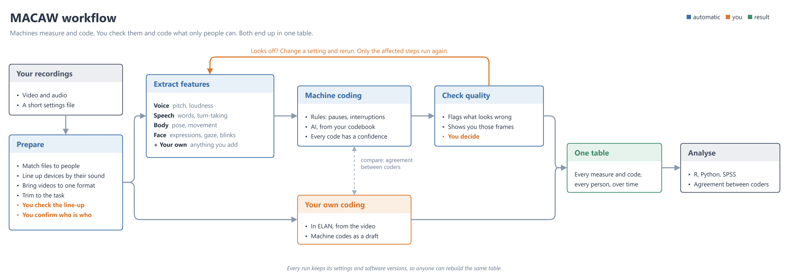

# MACAW

**M**ultimodal **A**utomated **C**oding **a**nd **A**nalysis **W**orkbench

From one or more recordings of a natural two-person (or N-person) interaction to an analysable multimodal feature time series.

| | |
|---|---|
| PyPI | `pymacaw` |
| import | `macaw` |
| CLI | `macaw` |

Status: pre-alpha. The audio and pose chains run end to end; the rest is in progress.

The [user guide](https://au-connect-lab.github.io/Multimodal-Automated-Coding-and-Analysis-Workbench/) walks through a project step by step.



## What it covers

Automatic multi-source alignment, feature extraction (prosody, transcript, pose, face, motion energy), quality control, rule-based and LLM-assisted behavioural coding, and two-way `.eaf` interchange with ELAN.

## On a Slurm cluster

Describe your cluster in an `hpc.yaml` next to `project.yaml`, starting from the one in the package (`macaw/config/hpc.yaml`): partitions, the GPU to ask for, the lines that load modules and activate the environment, and a shared folder for model weights. Then, on a login node:

```bash
macaw hpc prefetch-models -c project.yaml   # once: model weights into the shared folder; the jobs run offline
macaw hpc generate -c project.yaml          # writes the job arrays and prints the submit command
```

Steps that need a GPU and steps that do not run in separate job arrays, one element per recording, and each recording moves on to its next array by itself. A recording that stops for a person (checking offsets, naming voices) waits there; once that is done, run `macaw hpc generate` again, which leaves out whatever has finished.
