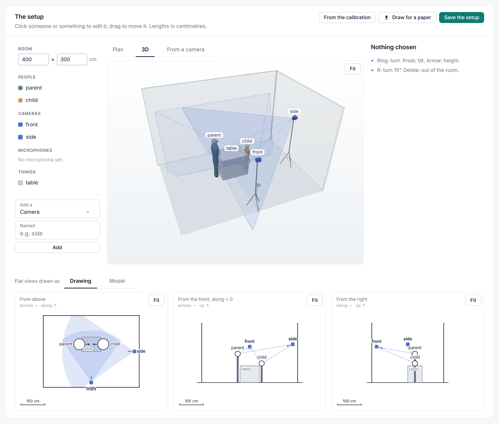
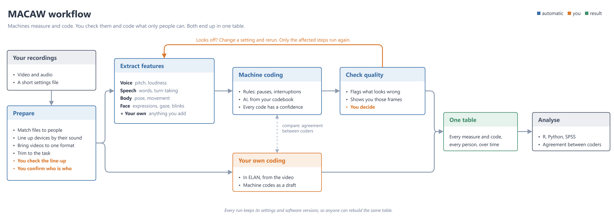
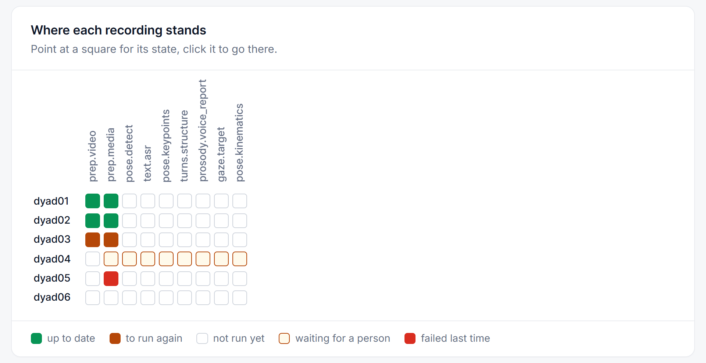

# MACAW

**M**ultimodal **A**utomated **C**oding **a**nd **A**nalysis **W**orkbench

MACAW derives time-resolved measures of voice, language, turn-taking, body movement, facial behaviour and gaze from audio and video recordings of dyadic and small-group interaction, and combines them in a single data set for statistical analysis. Decisions that software cannot make reliably, such as which voice belongs to which participant, are referred to the researcher, and every decision is recorded.

## Scope

- Alignment of recordings from separate devices by their sound.
- Acoustic, lexical, syntactic and turn-taking measures from automatic transcription with speaker attribution.
- Pose, movement, interpersonal distance, facial action units, head orientation and gaze, in two dimensions or, with several calibrated cameras, in three.
- Rule-based coding of pauses, interruptions and backchannels, and speech-act coding by a language model from a codebook, with human review of uncertain units.
- Every recording-level measure also within named segments of a recording, such as the phases of a task, marked on the video in the workbench.
- Import of human coding from ELAN or tables, inter-rater agreement (Krippendorff's alpha, Cohen's kappa), and export to ELAN.
- A quality-control report whose review frames a model that reads pictures can check first, with a person checking the model, a Methods section generated from the steps that were run, and a graphical workbench.

MACAW describes each recording; statistical inference and group comparisons remain with the researcher.

## Workflow

The workbench shows, for every recording and step, what is up to date, what is to run again, what waits for the researcher and what failed.

## Documentation

The [user guide](https://au-connect-lab.github.io/Multimodal-Automated-Coding-and-Analysis-Workbench/) covers installation, the standard procedure and the optional features.

| | |
|---|---|
| PyPI | `pymacaw` |
| import | `macaw` |
| CLI | `macaw` |

Status: pre-release. Names and settings may still change.
