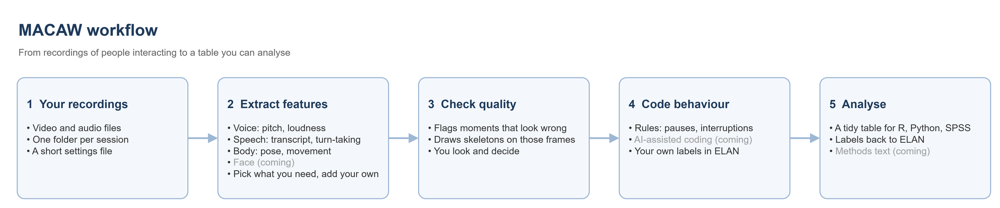

# MACAW

**M**ultimodal **A**utomated **C**oding **a**nd **A**nalysis **W**orkbench

From one or more recordings of a natural two-person (or N-person) interaction to
an analysable multimodal feature time series.

| | |
|---|---|
| PyPI | `pymacaw` |
| import | `macaw` |
| CLI | `macaw` |

Status: pre-alpha. The audio and pose chains run end to end; the rest is in progress.

The figure is a draw.io file with the diagram embedded in the PNG: open `docs/workflow.drawio.png` in draw.io (desktop, web, or the VS Code extension) to edit it, and save it as PNG with the diagram included.

## What it covers

Automatic multi-source alignment, feature extraction (prosody, transcript, pose,
face, motion energy), quality control, rule-based and LLM-assisted behavioural
coding, and two-way `.eaf` interchange with ELAN.